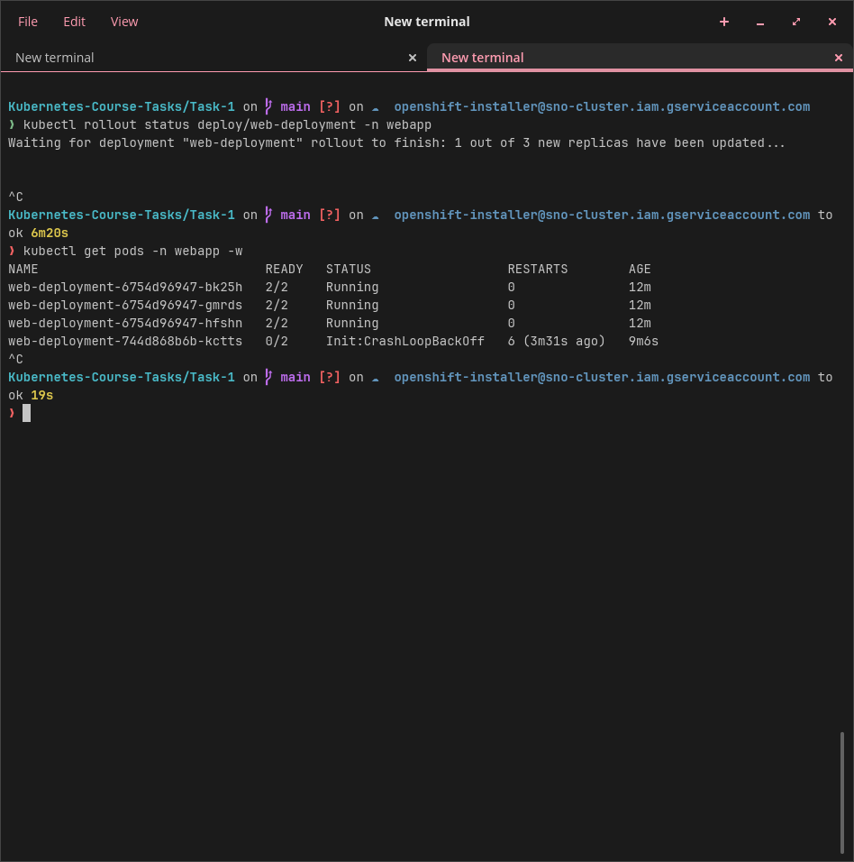
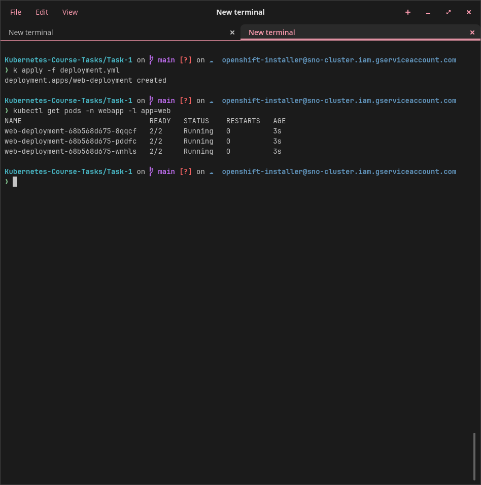
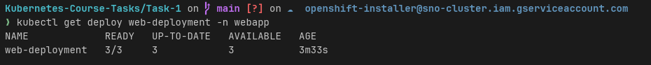
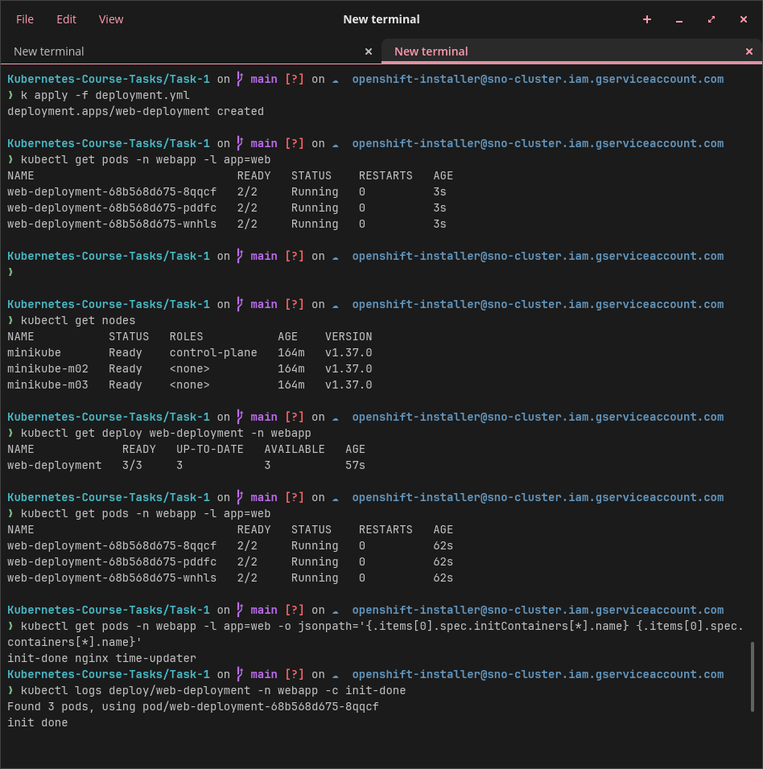
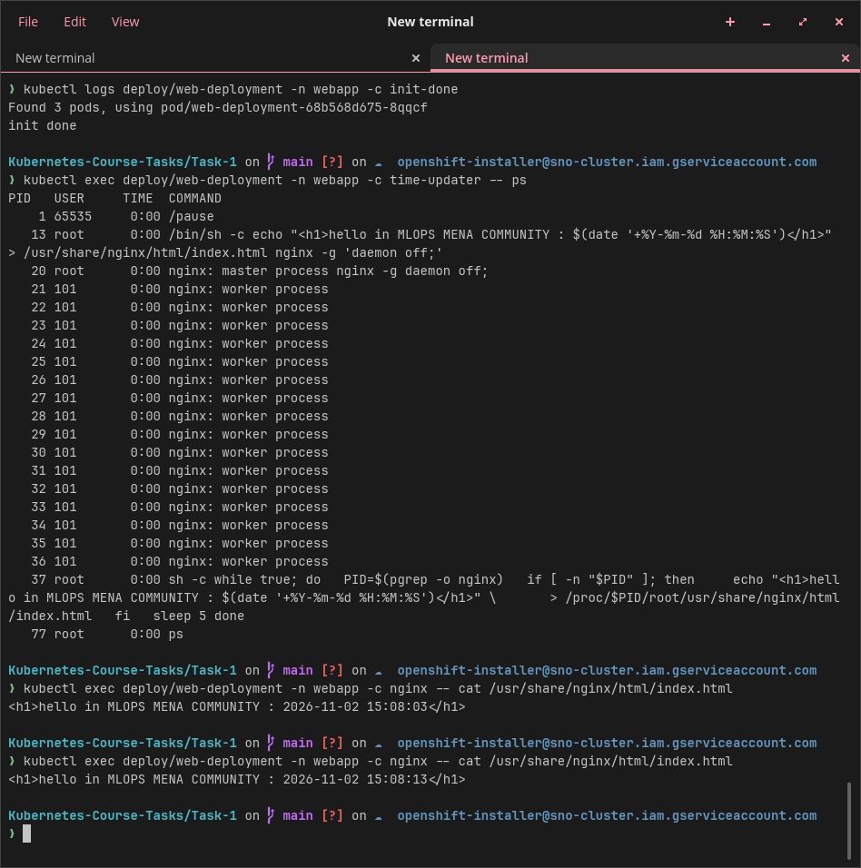

# 🧪 Task-1 — Multi-container Pods: Init Container & Sidecar

## 📝 Description

Run a "hello" page with **nginx** on a **3-node minikube cluster**. The page shows the current time:

```
hello in MLOPS MENA COMMUNITY : 2026-11-02 14:51:12
```

Each Pod has **three containers** and **no volume**:

| Container | Type | Job |
|---|---|---|
| `init-done` | Init container | Prints `init done` and exits. The other containers start only if it succeeds. |
| `nginx` | Main container | Writes `index.html` with the time, then serves it on port 80. |
| `time-updater` | Sidecar | Rewrites `index.html` with the new time **every 5 seconds**. |

At the end, the init container is made to **fail** to observe how Kubernetes reacts, then it is fixed again.

---

## 🧩 Architecture

```mermaid
flowchart TD
    subgraph P["Pod — shareProcessNamespace: true"]
        I["🧰 init-done<br/>busybox:1.36 — echoes init done and exits 0"]
        N["🌐 nginx<br/>nginx:1.27 — writes index.html with the time, serves :80"]
        T["⏱ time-updater<br/>busybox:1.36 + SYS_PTRACE — rewrites index.html every 5 s"]
    end
    I -->|"must succeed first"| N
    I -->|"must succeed first"| T
    T -->|"writes through<br/>/proc/&#60;nginx-pid&#62;/root"| N
```



Key points:

- The Pod sets **`shareProcessNamespace: true`**, so the sidecar can see the `nginx` process (`pgrep -o nginx`).
- The sidecar writes into the nginx container's filesystem through **`/proc/<nginx-pid>/root`...`index.html`** — no volume needed.
- The sidecar needs the **`SYS_PTRACE`** capability (`securityContext.capabilities.add`) to look into another process's `/proc`.

---

## 📁 Files in this folder

| File | Purpose |
|---|---|
| [`deployment.yml`](deployment.yml) | The Deployment manifest used for the task (working version) |
| `pics/` | Screenshots of every command run and the verification results |
| [`README.md`](README.md) | This document |

---

## 🧰 What You Need

- **Tools:** minikube, kubectl, Docker (minikube driver)
- **Cluster:** minikube v1.39.0, Kubernetes v1.37.0, Calico CNI, 1 control-plane + 2 workers

| Resource | Name |
|---|---|
| Namespace | `webapp` |
| Deployment / Pod label | `web-deployment` / `app: web` |
| Containers | `init-done`, `nginx`, `time-updater` |
| Images | `busybox:1.36` (init + sidecar), `nginx:1.27` |

> ℹ️ In the screenshots, `k` is a shell alias for `kubectl`.

---

## 🚀 Steps

### 1. Create the cluster

```bash
minikube start --nodes 3 --cni=calico --cpus 2 --memory 2200
kubectl get nodes              # check: 3 nodes Ready
```

All 3 nodes — `minikube` (control-plane), `minikube-m02`, `minikube-m03` — are **Ready** on v1.37.0.


### 2. Create the namespace

```bash
k create ns webapp
# namespace/webapp created
```

### 3. Write the Deployment

The manifest ([`deployment.yml`](deployment.yml)) defines:

- **`web-deployment`** in namespace `webapp`, **3 replicas**, Pod label **`app: web`** (in both `selector.matchLabels` and the Pod template).
- **No volumes**, and **`shareProcessNamespace: true`** in the Pod spec (next to `containers`).
- **Init container** `init-done` (`busybox:1.36`):

  ```yaml
  command: ["sh", "-c", "echo 'init done'"]
  ```

- **Main container** `nginx` (`nginx:1.27`, port 80) — the command writes the page, then starts nginx in the foreground:

  ```yaml
  command: ["/bin/sh", "-c"]
  args:
    - |
      echo "<h1>hello in MLOPS MENA COMMUNITY : $(date '+%Y-%m-%d %H:%M:%S')</h1>" > /usr/share/nginx/html/index.html
      nginx -g 'daemon off;'
  ```

- **Sidecar** `time-updater` (`busybox:1.36`) with the `SYS_PTRACE` capability:

  ```yaml
  while true; do
    PID=$(pgrep -o nginx)
    if [ -n "$PID" ]; then
      echo "<h1>hello in MLOPS MENA COMMUNITY : $(date '+%Y-%m-%d %H:%M:%S')</h1>" \
        > /proc/$PID/root/usr/share/nginx/html/index.html
    fi
    sleep 5
  done
  ```

### 4. Deploy and check

```bash
kubectl apply -f deployment.yml
kubectl get pods -n webapp -w                 # wait for 2/2 Running (Ctrl+C to stop)
kubectl get pods -n webapp -o wide            # Pods spread over minikube-m02 / minikube-m03
kubectl port-forward -n webapp deploy/web-deployment 8080:80   # keeps running: use a second terminal
```

All 3 Pods reach **2/2 Running** and the port-forward to `localhost:8080` is up:


### 5. Verify the page

Open **http://localhost:8080** — the page shows the current time:


Refreshing after ~5 seconds changes the time, because the `time-updater` sidecar rewrites `index.html` every 5 seconds through `/proc/<nginx-pid>/root`.

---

## 💥 Making the init container fail

Only the init container command was changed so it exits with code 1:

```yaml
command: ["sh", "-c", "echo 'init failed'; exit 1"]
```

Then re-applied the file (without deleting the Deployment):

```bash
kubectl apply -f deployment.yml
kubectl get pods -n webapp -w
kubectl logs <new-pod> -n webapp -c init-done
kubectl describe pod <new-pod> -n webapp
```

What happened:

- The **3 old Pods stay `2/2 Running`** (ReplicaSet `6754d96947`).
- The **new Pod** (`web-deployment-744d868b6b-kctts`, on `minikube-m02`) never gets past initialization: **`Init:Error` → `Init:CrashLoopBackOff`**, `READY 0/2`, restart count keeps climbing.
- The init container log shows `init failed`, and `describe pod` shows **`init-done: Exit Code: 1`** with the event `Back-off restarting failed container init-done`.


`kubectl rollout status` waits forever, because the new ReplicaSet can never become ready:

```bash
kubectl rollout status deploy/web-deployment -n webapp
# Waiting for deployment "web-deployment" rollout to finish: 1 out of 3 new replicas have been updated...
```



The Pod events confirm the loop — the init container is started, fails, and is backed off repeatedly:


### ✅ Answers to the Step-5 questions

| Question | Answer |
|---|---|
| Which status does the new Pod show? | `Init:Error` at first, then **`Init:CrashLoopBackOff`** with `READY 0/2` (the old 3 Pods stay `2/2 Running`). |
| Do `nginx` and `time-updater` start? | **No.** Init containers must finish successfully before the main containers start, so the Pod stays in the initialization phase. |
| Is the page still reachable, and why? | **Yes.** The 3 old Pods from the previous ReplicaSet are untouched and keep serving. The Deployment only keeps them until the new Pods are ready — since the new Pod never becomes ready, the old Pods remain the only endpoints, and `port-forward` still reaches them. |

---

## 🔧 Fixing it

The working init command was restored and the file re-applied. The new ReplicaSet (`68b568d675`) came up cleanly — all 3 Pods **2/2 Running** in seconds:



The Deployment reports healthy again: **READY 3/3, UP-TO-DATE 3, AVAILABLE 3**:



---

## 🔍 Verification

| # | Check | Command | Expected | Result |
|---|---|---|---|---|
| 1 | 3 nodes | `kubectl get nodes` | 3 nodes Ready | `minikube`, `minikube-m02`, `minikube-m03` Ready, v1.37.0 ✅ |
| 2 | Deployment ready | `kubectl get deploy web-deployment -n webapp` | READY 3/3 | `3/3`, UP-TO-DATE 3, AVAILABLE 3 ✅ |
| 3 | Pods running | `kubectl get pods -n webapp -l app=web` | 3 Pods, each 2/2 Running | 3 Pods `2/2 Running` ✅ |
| 4 | Containers | `kubectl get pods ... -o jsonpath='{.items[0].spec.initContainers[*].name} {.items[0].spec.containers[*].name}'` | init-done nginx time-updater | `init-done nginx time-updater` ✅ |
| 5 | Init succeeded | `kubectl logs deploy/web-deployment -n webapp -c init-done` | `done` | `init done` ✅ |
| 6 | Sidecar sees nginx | `kubectl exec deploy/web-deployment -n webapp -c time-updater -- ps` | `nginx: master process` in the list | `nginx: master process nginx -g daemon off;` (PID 20) visible ✅ |
| 7 | Time updates | `kubectl exec ... -c nginx -- cat /usr/share/nginx/html/index.html` (twice, 5 s apart) | new time each time | `15:08:03` → `15:08:13` ✅ |
| 8 | No volumes | `kubectl get deploy web-deployment -n webapp -o jsonpath='{.spec.template.spec.volumes}'` | Empty | Empty — no volumes in the manifest ✅ |
| 9 | Failing init (step above) | `kubectl get pods -n webapp -l app=web` | `Init:Error` → `Init:CrashLoopBackOff`, READY 0/2; old Pods stay 2/2 | exactly as expected ✅ |
| 10 | Init error details | `kubectl describe pod <new-pod> -n webapp` | `init-done: Exit Code: 1` | Exit Code 1 + `Back-off restarting failed container init-done` ✅ |
| 11 | Fixed | `kubectl get deploy web-deployment -n webapp` | READY 3/3, UP-TO-DATE 3 | `3/3`, UP-TO-DATE 3, AVAILABLE 3 ✅ |

> ℹ️ **READY shows 2/2:** the init container has finished, so only `nginx` and `time-updater` count.

**Checks 1–5** (nodes, deployment, Pods, container names, init log):



**Checks 5–7** (init log, sidecar sees the nginx process, time keeps updating):



---

## 🧹 Clean Up (optional)

The cluster is kept for Task 2. To remove only this task's namespace:

```bash
kubectl delete namespace webapp
```
