# 🧪 Task-2 — FastAPI + MySQL on Kubernetes (behind an Ingress)

## 📝 Description

A two-tier app deployed on a multi-node **minikube** cluster (3 nodes: `minikube`, `minikube-m02`, `minikube-m03`), served through **NGINX Ingress**.

| Resource | Name |
|---|---|
| Namespace | `webapp-stack` |
| Secret | `mysql-secret` (DATA 3 — `MYSQL_USER`, `MYSQL_PASSWORD`, `MYSQL_ROOT_PASSWORD`) |
| ConfigMap | `webapp-config` (DATA 5 — `APP_TITLE`, `MYSQL_DATABASE`, `MYSQL_HOST`, `MYSQL_PORT`, `APP_ENV`) |
| Storage | `mysql-pv` (hostPath, 2Gi, pinned to `minikube-m02`) → `mysql-pvc` (Bound) |
| Workloads | `mysql` (1/1, `Recreate` strategy, RWO volume) + `webapp-api` (2/2, probes on `/health`) |
| Ingress | `webapp-ingress` (class `nginx`) → `webapp-api:80` |
| Images | `webapp-api:task2`, `webapp-mysql:task2` |

---

## 📁 Files in this folder

| File | Purpose |
|---|---|
| [`ns.yml`](ns.yml) | Namespace `webapp-stack` |
| [`secrets.yml`](secrets.yml) | Secret `mysql-secret` |
| [`configmap.yml`](configmap.yml) | ConfigMap `webapp-config` |
| [`pv.yml`](pv.yml) / [`pvc.yml`](pvc.yml) | 2Gi hostPath volume pinned to `minikube-m02` |
| [`mysql-deploy.yml`](mysql-deploy.yml) / [`mysql-srv.yml`](mysql-srv.yml) | MySQL deployment + ClusterIP service |
| [`api-deploy.yml`](api-deploy.yml) / [`api-srv.yml`](api-srv.yml) | FastAPI deployment + ClusterIP service |
| [`ingress.yml`](ingress.yml) | NGINX ingress rule `/` → `webapp-api:80` |
| `images/` | Screenshots of every check and the running app |
| [`README.md`](README.md) | This document |

---

## 🚀 Steps

Apply everything in order:

```bash
kubectl apply -f ns.yml
kubectl apply -f secrets.yml -f configmap.yml
kubectl apply -f pv.yml -f pvc.yml
kubectl apply -f mysql-srv.yml -f mysql-deploy.yml
kubectl apply -f api-srv.yml -f api-deploy.yml
kubectl apply -f ingress.yml
```

Checks 9–11 need the API on `localhost:8080` — keep this running in a second terminal:

```bash
kubectl port-forward -n webapp-stack svc/webapp-api 8080:80
```

> 💡 On Windows PowerShell, use `curl.exe` instead of `curl`, and write the JSON of check 10 as `'{\"author\":\"student\",\"content\":\"hello\"}'`.

---

## 🔍 Verify

### 1. Images loaded

```bash
minikube image ls | grep webapp
```

Expected: `webapp-api:task2`, `webapp-mysql:task2`

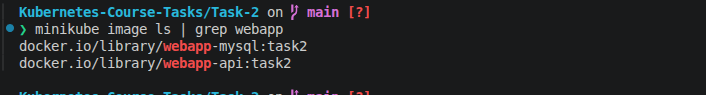

### 2. Secret and ConfigMap

```bash
kubectl get secret mysql-secret -n webapp-stack
kubectl get configmap webapp-config -n webapp-stack
```

Expected: DATA 3 and 5

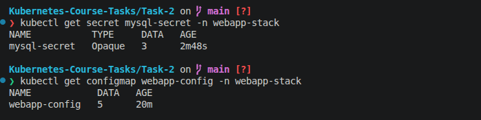

### 3. PV and PVC bound

```bash
kubectl get pv mysql-pv
kubectl get pvc mysql-pvc -n webapp-stack
```

Expected: Bound, 2Gi

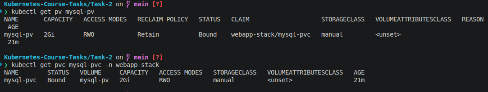

### 4. Deployments ready

```bash
kubectl get deploy -n webapp-stack
```

Expected: mysql 1/1, webapp-api 2/2

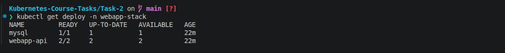

### 5. MySQL on the PV node

```bash
kubectl get pods -n webapp-stack -l app=mysql -o wide
```

Expected: 1/1 Running, NODE minikube-m02

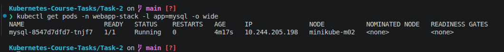

### 6. App env

```bash
kubectl exec -n webapp-stack deploy/webapp-api -- env
```

Expected: APP_TITLE, MYSQL_HOST=mysql, MYSQL_USER, MYSQL_PASSWORD

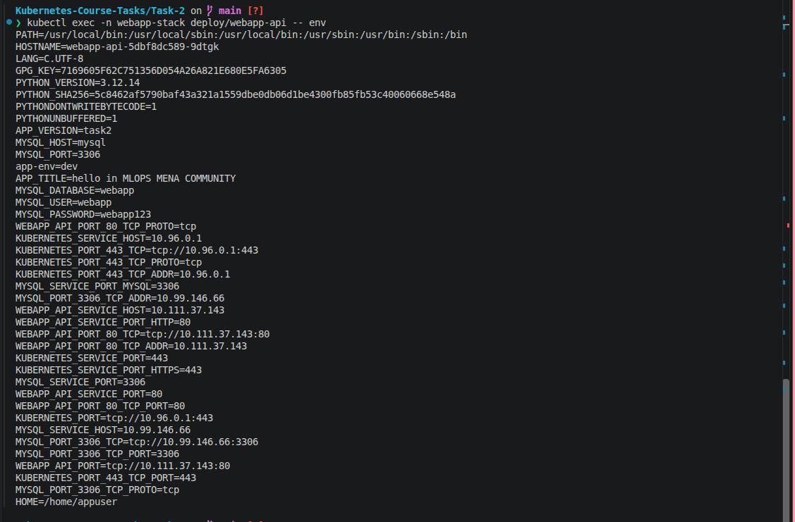

### 7. Default data

```bash
kubectl exec -n webapp-stack deploy/mysql -- sh -c 'mysql -uroot -p"$MYSQL_ROOT_PASSWORD" -e "SELECT * FROM webapp.messages"'
```

Expected: 2 default messages

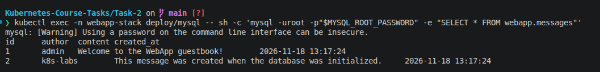

### 8. Ingress

```bash
kubectl get ingress webapp-ingress -n webapp-stack
```

Expected: CLASS nginx, ADDRESS filled

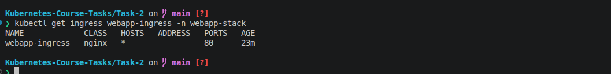

### 9. App info

```bash
curl http://localhost:8080/api/info
```

Expected: `"version": "task2"`, `"title": "hello in MLOPS MENA COMMUNITY"`, `"environment": "dev"`, db with the MySQL server

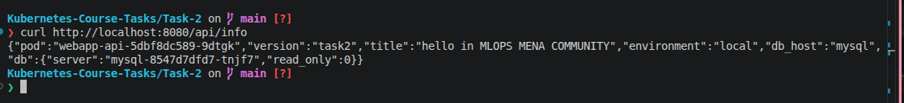

### 10. Write a message

```bash
curl -X POST http://localhost:8080/api/messages -H "Content-Type: application/json" -d '{"author":"student","content":"hello"}'
```

Expected: `{"id": 3, "written_to": "mysql-..."}`

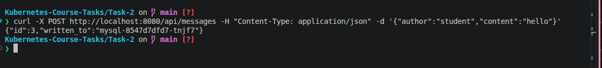

### 11. Read messages

```bash
curl http://localhost:8080/api/messages
```

Expected: your message + the 2 default ones

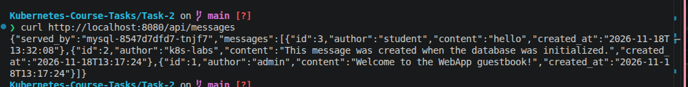

### 12. Data survives a restart

```bash
kubectl delete pod -n webapp-stack -l app=mysql
# wait for the new mysql pod to be Running, then repeat check 11
curl http://localhost:8080/api/messages
```

Expected: your message is still there

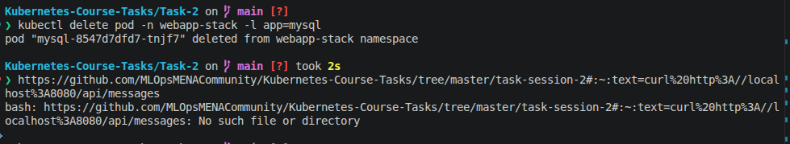

---

## 🌐 Running app

The app served through the Ingress at `http://192.168.49.2:31449/` (minikube IP + ingress-nginx NodePort):

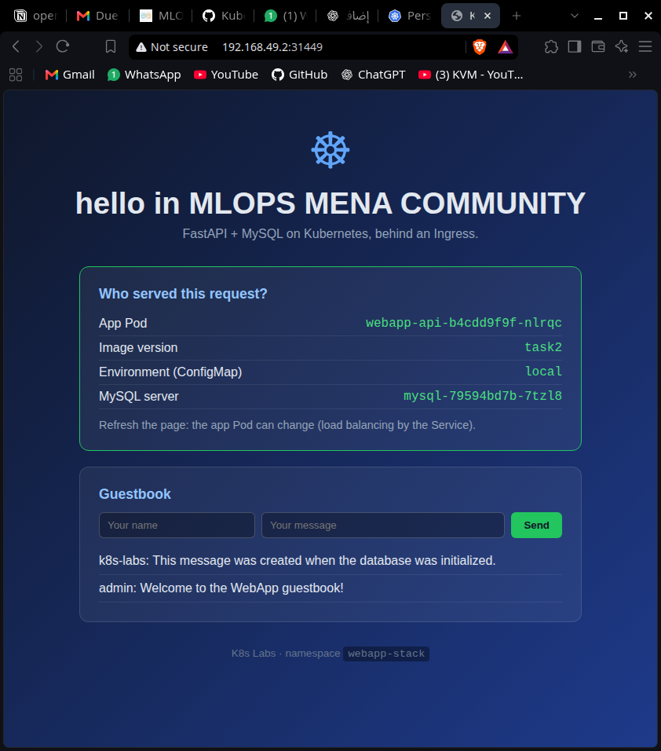

---

## 🧹 Clean Up (optional)

```bash
kubectl delete namespace webapp-stack
kubectl delete pv mysql-pv
```
